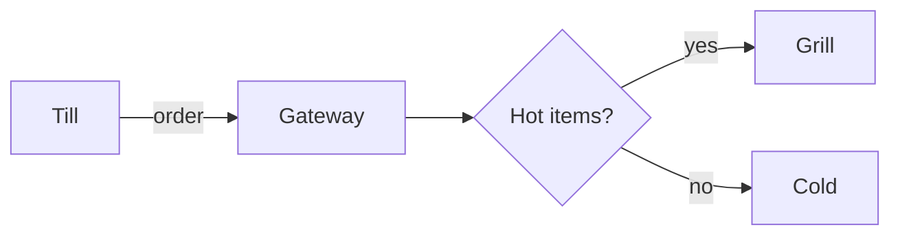
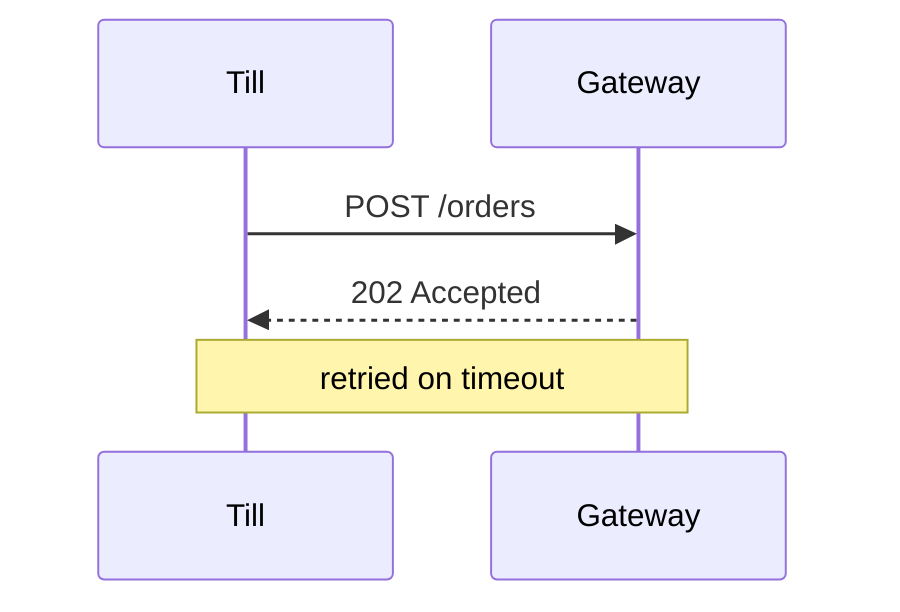
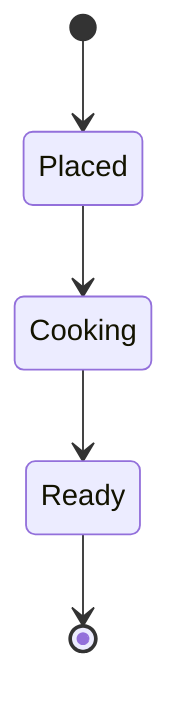

# Order pipeline

How an order travels from the till to the kitchen. See [the request lifecycle](02-request-lifecycle.md#retries) and `OrderRouter`.

## Components

| Component | Owner | Latency (p95) |
| :-------- | :---: | ------------: |
| Gateway   | edge  |         12 ms |
| Router    | core  |          4 ms |
| `Kitchen` | ops   |         30 ms |

### Routing

```ts
export function route(order: Order): Station {
  return order.items.some((item) => item.hot) ? "grill" : "cold";
}
```



### Handshake



## States



- Placed orders wait at most **30 s**.
  - After that the till *warns* the cashier.
- Ready orders are ~~printed~~ shown on the screen.
